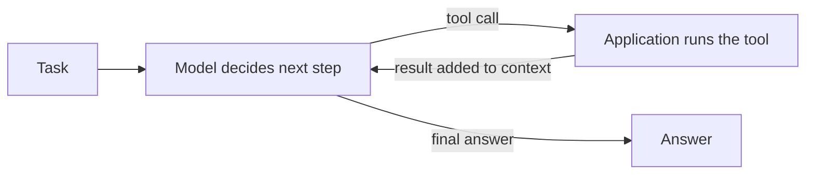

# Step 1. How an agent works

Every later step adds something to the loop described here, so it is worth understanding first.

## Model

A large language model (LLM) takes text in and produces text out. On its own it remembers nothing between calls and cannot act: it cannot read the clock, open a file or call a web API.

## Context window

Everything the model sees in one call: the system prompt, the conversation so far, the definitions of the tools it may use, the results of earlier tool calls, and any files pasted in. Its size is limited, and the model knows nothing that is not in it. Steps 3 to 5 are all about deciding what goes into the context, and when.

## Tool

A function that the application around the model offers to it, described by a name, a description and a JSON schema for its arguments. The model cannot run it. It replies with a request such as "call `get_current_time` with `timezone="Asia/Tokyo"`"; the application runs the function and sends the result back in the next call. This mechanism is called **function calling** or **tool use**, and every major model API supports it.

## Agent

A model running in a loop with tools. It reads the task, decides on a step, calls a tool, reads the result, and decides the next step, until it judges the task done or hits a limit.



The program that runs the loop is called the **host** or **harness**. It decides which tools the model gets, asks the user for permission before risky calls, and manages the context. In this lab the host is the agent in your IDE: GitHub Copilot's agent mode in VS Code, or Claude Code. Cursor and Gemini CLI work the same way.

## How the model "decides" to call a tool, and when to stop

Nothing in an agent decides in the human sense. There is no planning module and no checklist that marks the task as done. There is only the model predicting the next token, and ordinary code reading what it produced.

**Tools are text in the prompt.** The host turns each tool's name, description and schema into formatted text placed in the context, next to the system prompt and the question. The model reads "these functions exist and this is what they do" like any other part of the prompt.

**A tool call is text in a special format.** At each step the model can write either an ordinary answer or a tool call. Internally both are a stream of tokens; a tool call is wrapped in special marker tokens learned during training. Open models show this in their chat templates. Qwen, for example, writes:

```text
<tool_call>
{"name": "get_current_time", "arguments": {"timezone": "Asia/Tokyo"}}
</tool_call>
```

**Parsers turn that text into a call.** Two pieces of ordinary software sit between the model and your tool:

1. The model provider's server watches the output for the markers, extracts the JSON and returns it as a structured `function_call` field instead of text. With an open model you host yourself, the inference server (vLLM, Ollama) does this step.
2. The host reads that field, finds the matching function, runs it, and sends the result back as a new message.

If the model writes invalid JSON or names a tool that does not exist, the call fails and the error is usually sent back to the model so it can try again. Many APIs can prevent this with **constrained decoding**: while the model generates a call, every token that would break the schema is blocked, so the output always parses.

**Training is why it calls at the right moment.** After pretraining, models are fine-tuned on many conversations in which calling a tool was the right move, and rewarded when their calls lead to correct results. They learn patterns such as: the question needs information that is not in the context (the current time, a live price), so emit a call; the request matches this tool's description, so use that tool; the results already in the context answer the question, so write the answer. This is why tool descriptions matter so much: they are the only thing the model can match the request against.

**Stopping is the same mechanism.** The host's loop is a few lines:

```text
while the model's reply contains tool calls:
    run each call and add its result to the context
    send the whole context to the model again
return the reply's text
```

The loop ends when the model writes a reply with no tool call, followed by an end-of-turn token. "Thinking" works the same way: reasoning models first write hidden reasoning text and stop when they emit an end-of-thinking marker, a habit also learned in training.

**The host adds hard limits, because the model can be wrong.** It can loop, call tools it does not need, or answer from memory when it should have called a tool, for example guessing the time from its training data. So hosts also stop on a maximum number of calls, on token budgets, on timeouts, and when the user rejects a call. Developers using a model API can also take the choice away: function-calling APIs accept a mode of "auto" (the model chooses, the default), "any" (it must call a tool) or "none" (it cannot).

## Try it

Before connecting any tools, see what the model does without them.

1. In VS Code, open the Chat view, switch to **Agent** mode, click the tools icon and untick the `time` and `public_ip` servers. In Claude Code, start it with `claude --strict-mcp-config` so it loads no MCP servers.
2. Ask: *"What time is it in Tokyo right now?"*
3. Did it refuse, guess, or find another way (some agents run `date` in a terminal, which is also a tool)? Whichever it did, the answer did not come from the model's own knowledge of the present: it has none.

Keep the answer. In step 2 you give the agent a proper tool for this.
