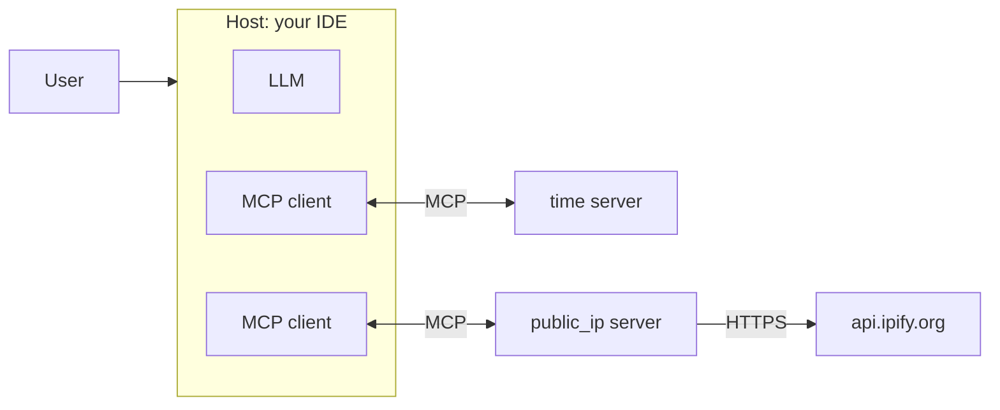

# Step 2. Tools and MCP

Step 1 described tools: functions that a host offers to a model. This step gives your IDE agent two new tools, packaged as MCP servers.

| Server | Tool | What it returns |
|---|---|---|
| [servers/time_server.py](servers/time_server.py) | `get_current_time(timezone)` | Current date and time in any IANA time zone |
| [servers/ip_server.py](servers/ip_server.py) | `get_public_ip(version)` | Your public IP address, looked up with [ipify](https://www.ipify.org) |

## What MCP is

Each AI application used to define tools its own way. A GitHub integration written for one IDE had to be rewritten for another IDE, for a chat app and for each model provider: N applications times M integrations.

**The Model Context Protocol (MCP) is an open standard for packaging tools so that any AI application can use them.** You write a tool once, as an MCP server, and every MCP-compatible host can plug it in: VS Code, Cursor, Claude Code, Claude Desktop, Gemini CLI, ChatGPT, or your own Python script. Anthropic published MCP in November 2024; it is now governed by the Linux Foundation and supported by OpenAI, Google and Microsoft. The usual analogy is USB-C: one connector instead of a different cable per device.

## How it works

### Three roles

- **Host**: the AI application the user interacts with (VS Code, Claude Code). It owns the model and runs the agent loop.
- **Client**: a connection inside the host, one per server. It speaks the protocol.
- **Server**: a program that exposes capabilities. Ours are the two Python files in `servers/`.



The model never talks to an MCP server. The host reads the server's tool list, passes it to the model as ordinary tool definitions, and runs whatever calls the model asks for. MCP standardizes the host-to-server side; function calling is still how the model asks.

### What a server can offer

| Primitive | Who decides to use it | Example |
|---|---|---|
| **Tools** | The model | `get_current_time`, `create_issue`, `run_query` |
| **Resources** | The application or user | Read-only data such as a file, a table schema or a log |
| **Prompts** | The user | Reusable prompt templates, often shown as slash commands |

Tools are by far the most used, and the only primitive this lab needs.

### Two transports

- **stdio**: the host starts the server as a subprocess and they exchange messages over its standard input and output. Simple, local, no network, no authentication. This is how IDEs usually run servers, and how ours run.
- **Streamable HTTP**: the server listens on a URL. Needed when the server runs on another machine or is shared by many users, for example a company's MCP server for its internal database.

### The messages

Under the hood MCP is [JSON-RPC 2.0](https://www.jsonrpc.org/specification). A session has three steps.

1. `initialize`: client and server agree on a protocol version and say what they support. The real reply from our time server:

   ```json
   {
     "jsonrpc": "2.0",
     "id": 1,
     "result": {
       "protocolVersion": "2025-06-18",
       "capabilities": {
         "tools": {"listChanged": false},
         "resources": {"listChanged": false, "subscribe": false},
         "prompts": {"listChanged": false}
       },
       "serverInfo": {"name": "time", "version": ""}
     }
   }
   ```

2. `tools/list`: the client asks which tools exist. Each comes with a JSON schema that the Python SDK builds from the function's type hints and docstring:

   ```json
   {
     "name": "get_public_ip",
     "description": "Return the public IP address this machine uses on the internet, looked up with ipify.org. ...",
     "inputSchema": {
       "type": "object",
       "properties": {
         "version": {
           "type": "string",
           "enum": ["ipv4", "any"],
           "default": "ipv4"
         }
       }
     }
   }
   ```

3. `tools/call`: the client runs one, with arguments, and gets the result back as content.

The description and schema are all the model knows about a tool, so they are part of your prompt. A vague docstring produces wrong calls.

## The two servers

A complete MCP server is a few lines. This is the core of [servers/time_server.py](servers/time_server.py):

```python
from mcp.server.mcpserver import MCPServer

mcp = MCPServer("time")

@mcp.tool()
def get_current_time(timezone: str = "UTC") -> dict:
    """Return the current date and time of this machine's clock in the given time zone.

    Args:
        timezone: IANA time zone name, for example "Europe/Madrid" or "America/New_York".
    """
    now = datetime.now(ZoneInfo(timezone))
    return {"timezone": timezone, "iso": now.isoformat(timespec="seconds"), ...}

mcp.run()  # stdio
```

`@mcp.tool()` registers the function; its name, docstring and type hints become the tool's name, description and input schema. Raising an exception sends an error result back to the model, which can then retry with corrected arguments.

[servers/ip_server.py](servers/ip_server.py) is the same pattern with two differences: the tool is `async` because it waits on a network call to `https://api.ipify.org`, and its argument is typed `Literal["ipv4", "any"]`, which becomes an `enum` in the schema so the model knows the only valid values.

This lab uses version 2 of the official [`mcp` Python SDK](https://github.com/modelcontextprotocol/python-sdk). Many tutorials online use version 1, where the server class was called `FastMCP` (`from mcp.server.fastmcp import FastMCP`). In version 2 it is `MCPServer` (`from mcp.server.mcpserver import MCPServer`); the decorators work the same way.

## Talk to the servers without a model

[list_and_call.py](list_and_call.py) does exactly what a host does, with no LLM: start each server, list its tools, call one. Run it from the root of the repository:

```bash
uv run 02-tools-and-mcp/list_and_call.py
```

```text
Connected to server 'time'
  tool get_current_time: Return the current date and time of this machine's clock in the given time zone.
    input schema:
      {
        "properties": {
          "timezone": {
            "default": "UTC",
            "title": "Timezone",
            "type": "string"
          }
        },
        "type": "object",
        "title": "get_current_timeArguments"
      }
  call get_current_time({'timezone': 'Europe/Madrid'}) ->
    {
      "timezone": "Europe/Madrid",
      "iso": "2026-10-27T11:48:22+01:00",
      "weekday": "Tuesday",
      "utc_offset": "+0100"
    }

Connected to server 'public_ip'
  tool get_public_ip: Return the public IP address this machine uses on the internet, looked up with ipify.org.
    input schema:
      {
        "properties": {
          "version": {
            "default": "ipv4",
            "enum": [
              "ipv4",
              "any"
            ],
            "title": "Version",
            "type": "string"
          }
        },
        "type": "object",
        "title": "get_public_ipArguments"
      }
  call get_public_ip({}) ->
    {
      "ip": "203.0.113.42",
      "source": "ipify.org"
    }
```

For a visual version, the **MCP Inspector** opens a web page where you can browse a server's tools and call them by hand (needs Node.js):

```bash
uv run mcp dev 02-tools-and-mcp/servers/time_server.py
```

## Connect the servers to your IDE agent

Every MCP host has a config file that says how to start each server. This repository includes two, at its root:

| Host | Config file | How to check it works |
|---|---|---|
| VS Code (Copilot agent mode) | [.vscode/mcp.json](../.vscode/mcp.json) | Open the Chat view, switch to **Agent** mode, click the tools icon: `time` and `public_ip` should be listed. |
| Claude Code | [.mcp.json](../.mcp.json) | Start `claude` at the root of the repository, approve the project servers, run `/mcp`. |

The VS Code file looks like this; Claude Code's differs only in the top-level key (`mcpServers` instead of `servers`), which is also what Cursor (`.cursor/mcp.json`) and Gemini CLI (`.gemini/settings.json`) expect:

```json
{
  "servers": {
    "time": {
      "type": "stdio",
      "command": "uv",
      "args": ["run", "--directory", "${workspaceFolder}", "02-tools-and-mcp/servers/time_server.py"]
    }
  }
}
```

Two common problems: the IDE cannot find `uv` because it was started without your shell's `PATH` (use the full path from `which uv` as `command`), or the server crashes on start (run `uv run 02-tools-and-mcp/servers/time_server.py` in a terminal to see the error; it should wait silently for input, stop it with Ctrl+C).

## Try it

1. Make sure both servers are enabled, and ask the question from step 1 again: *"What time is it in Tokyo right now?"*. The chat shows the tool call, usually with an approval button. Compare with the answer you got in step 1.
2. Ask *"What time is it in Sydney and in Lima, and what's my public IP?"*. How many tool calls does the agent make, and in what order?

## Security

An MCP server is code running with your permissions, and its tool descriptions go straight into the model's prompt. Before installing a third-party server:

- **Only run servers you trust.** A stdio server can read your files and use your credentials like any program you run.
- **Tool descriptions and results are untrusted input.** A malicious server, or a web page a tool returns, can contain instructions aimed at the model (prompt injection). Keep the approval step for tool calls switched on.
- **Tool results leave your machine.** Whatever a tool returns is sent to the model provider. `get_public_ip` sends your IP address to whichever provider your IDE uses. Return only what the model needs.
- **HTTP servers need authentication** before they are exposed beyond your own machine.

Step 6 shows prompt injection in practice and how to enforce these rules in the harness.

## Exercises

1. Add a tool `convert_time(time, from_timezone, to_timezone)` to the time server. Restart the server (in VS Code, the restart action next to it in `.vscode/mcp.json`), then check that the agent uses it for *"What time is 15:00 in Madrid in New York?"*.
2. Make `get_public_ip` also return the approximate country, using the free `https://ipapi.co/<ip>/json/` endpoint. What does the security section above mean for this tool?
3. Rewrite the docstring of `get_current_time` to say only "Gets time." and restart the server. Ask about the time in a few cities. Does the agent still pass a valid time zone? Why?
4. Write a new MCP server for an API of your choice (weather, exchange rates, public transport) and add it to both config files.

## Further reading

- MCP specification and documentation: <https://modelcontextprotocol.io>
- Official Python SDK: <https://github.com/modelcontextprotocol/python-sdk>
- VS Code MCP servers: <https://code.visualstudio.com/docs/copilot/chat/mcp-servers>
- Claude Code MCP: <https://docs.claude.com/en/docs/claude-code/mcp>
