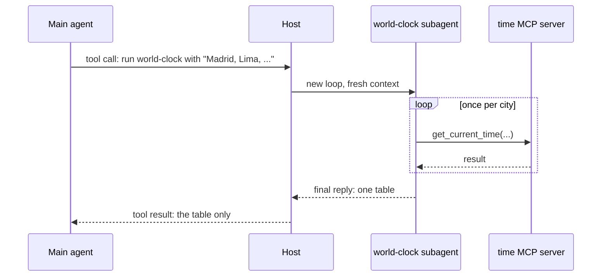

# Step 5. Subagents

## What a subagent is

A subagent is an agent started by another agent to handle one sub-task, with its own fresh context. It returns only its conclusion, so the main agent's context is not filled with everything the subagent read along the way, and several subagents can run in parallel. Systems built from several cooperating agents are called **multi-agent systems**.

## A subagent is started with a tool

To the main agent, starting a subagent is just another tool call:

1. The host offers the main model a tool for delegating. VS Code calls it `runSubagent`; Claude Code calls it `Agent`. Its arguments include the task, written by the main model.
2. The main model decides to call it, the same way it decides to call `get_current_time` (step 1).
3. The host runs that call by starting a **new agent loop**. Its context holds only the subagent's own instructions and the task text, not the main conversation.
4. The subagent runs until it writes a reply with no tool call.
5. The host returns that reply as the **tool result** of the main agent's call.



The task text is the subagent's whole picture of the problem. A vague task gives a vague result, exactly as a vague tool description leads to bad calls.

Two other ways to involve several agents:

- **Handoff:** the first agent passes the whole conversation to a specialist and stops, instead of waiting for a result, as a triage agent routes a customer to a billing agent.
- **Orchestration in code:** a program starts the agents itself, for example "run three reviewers in parallel, then a judge". No model decides; it is more predictable and less flexible.

## This repository's subagent

[.claude/agents/world-clock.md](../.claude/agents/world-clock.md) defines a subagent that looks up the time in a list of cities and returns one table:

```markdown
---
name: world-clock
description: Looks up the current local time in a list of cities and returns one compact table. Use when a task needs the current time in three or more places.
---

You are a world clock. You receive a list of cities.

For each city, work out its IANA time zone and call the `get_current_time` tool once. Use no other tool.

Reply with only a Markdown table ...
```

Like a skill, its `description` is what the main agent matches tasks against; the body becomes the subagent's system prompt. Claude Code reads it from `.claude/agents/`, and VS Code reads the same folder in this format (its own format lives in `.github/agents/*.agent.md`). Both formats can also list the tools the subagent may use, to give it fewer than the main agent.

## Try it

1. Start a new chat and ask *"Use the world-clock subagent to get the current time in Madrid, Lima, Nairobi, Mumbai, Jakarta, Seoul, Sydney, Auckland, Honolulu, Anchorage, Reykjavik and Cairo."*
2. Watch the chat: the subagent's twelve `get_current_time` calls appear inside its own collapsed block, and the main agent receives one table.
3. Start another new chat and ask the same question without mentioning the subagent. Does the main agent delegate on its own (the description says "three or more places"), or make the twelve calls itself?
4. In Claude Code, run `/context` after each of the two chats and compare how much of the main context was used.

## Exercises

1. Restrict the subagent to the time tool only. In Claude Code add `tools: mcp__time__get_current_time` to the frontmatter; in VS Code, write a `.github/agents/world-clock.agent.md` version with a `tools` list. Ask it for your public IP. What happens?
2. Write a second subagent, `network-inspector`, that uses only `get_public_ip`. Then ask a question that needs both subagents. Does the main agent run them in parallel?
3. When is a subagent worse than doing the work in the main conversation? Think about what the main agent cannot see afterwards.

## Further reading

- Subagents in VS Code: <https://code.visualstudio.com/docs/copilot/agents/subagents>
- Subagents in Claude Code: <https://docs.claude.com/en/docs/claude-code/sub-agents>
