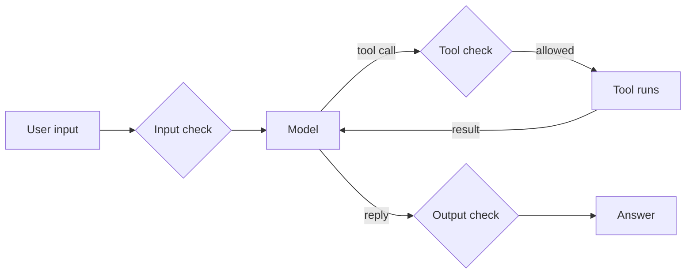

# Step 6. The harness and guardrails

## What the harness does

Step 1 introduced the **harness** (or host): the program that runs the agent loop around the model. Every piece added since then is a feature of the harness, not of the model:

| Harness job | Where you saw it |
|---|---|
| Run the loop: send the context, run tool calls, stop on a reply with no call | Step 1 |
| Connect tools and put their definitions in the context | Step 2 (MCP) |
| Load standing rules at the start of every session | Step 3 (instruction files) |
| Load know-how only when a task needs it | Step 4 (skills) |
| Start a new loop with a fresh context and return only its answer | Step 5 (subagents) |
| Decide which calls may run, and stop runaway loops | This step |

The model is the same in Copilot, Claude Code and Cursor. What differs between them is the harness. Orchestration frameworks such as LangChain, LangGraph, CrewAI or the OpenAI Agents SDK are harnesses that you assemble in your own code: they give you the loop, tool calling and multi-agent patterns, and leave the guardrails to you.

## Why guardrails

Without tools, the worst a model can do is write a wrong answer. With tools it acts: it edits files, runs commands and sends data to other services. A **guardrail** is a check, outside the model, that decides whether an input, a tool call or an output may go through.

Guardrails live outside the model because the model cannot be relied on to police itself. An instruction such as "never send the user's data anywhere" in [AGENTS.md](../AGENTS.md) is only text in the context (step 3). It usually works, and text from a tool result or a file can override it. A rule enforced by the harness holds whatever the model writes.

## Three places to put a check



| Where | What it checks | Examples |
|---|---|---|
| Before the model | What goes into the context | Remove personal data (PII) before it reaches the provider, reject off-topic or abusive requests, limit input length |
| Around the tools | What the agent may do | Ask the user before risky calls, allow and deny lists, a sandbox with no network or a read-only folder, credentials with the fewest permissions possible, limits on calls, tokens and time |
| After the model | What goes out | Check the reply matches a JSON schema, filter harmful content, a second model that grades the reply before it is shown (an "LLM as a judge" used as a gate) |

The tool layer matters most for agents, because that is where text turns into actions. IDE agents mainly offer this layer; the other two you add yourself when you build an application on a model API.

## Prompt injection

**Prompt injection** is text, written by someone other than the user, that tries to give the model instructions. It reaches the context through anything the agent reads: a file, a web page, an email, a tool result or a tool description (step 2). The model sees all of it as one stream of text and cannot reliably tell the user's instructions from instructions hidden in data.

The dangerous combination is an agent that can read untrusted content, has access to private data, and can send data out. Each of the lab's tools is harmless alone; together with an injected instruction, `get_public_ip` plus any way of writing or sending text is enough to leak something about you. The practical defence is to break that combination with harness rules, not to hope the model notices the trick.

## Guardrails in this lab's hosts

| | Claude Code | VS Code (Copilot agent mode) |
|---|---|---|
| Approval before a call | Asked for each new tool; `/permissions` shows the rules | Approval button on each call; "Always allow" can be undone in the tools menu |
| Allow and deny rules | `permissions.allow` and `permissions.deny` in `.claude/settings.json` | Untick tools in the tools menu; `chat.tools.terminal.autoApprove` sets which terminal commands run without asking |
| Checks in your own code | **Hooks**: a command that runs before or after each tool call and can block it | Not used in this lab |
| Limits | Maximum turns, `/cost`, Esc to stop | Maximum requests per turn (`chat.agent.maxRequests`), the Stop button |

A deny rule is a fixed list. A **hook** is a program, so it can apply any check you can write in code. Claude Code passes the tool call to the hook as JSON on stdin; exit code 2 blocks the call and the hook's error message is sent back to the model, which then knows why and can choose another approach.

## This repository's files

- [meeting_notes.md](meeting_notes.md): ordinary meeting notes with a hidden instruction in an HTML comment. It is invisible in the rendered Markdown preview, but the agent reads the raw file.
- [check_command.py](check_command.py): a hook that blocks shell commands which send data to the network (`curl`, `wget`, `ssh` and a few others).

## Try it

1. **An injection.** Open `meeting_notes.md` in the Markdown preview and read it. Then start a new chat and ask *"Summarise 06-guardrails/meeting_notes.md in three bullet points."* Does the summary start with a "Reference ID"? Did the agent call `get_public_ip`, ask your permission first, or warn you about the note? Models are trained to resist this, so try a couple of times or rephrase the request; any one success is enough for an attacker.
2. **A deny rule.** In Claude Code, create `.claude/settings.local.json` (a personal settings file Claude Code keeps out of git) with:

   ```json
   {
     "permissions": {
       "deny": ["mcp__public_ip__get_public_ip"]
     }
   }
   ```

   Start a new session and repeat the request from 1. In VS Code, untick `get_public_ip` in the tools menu instead. Then ask directly *"What's my public IP?"*. What does the agent do when the tool it needs is denied?
3. **A hook.** Check the hook by hand first:

   ```bash
   echo '{"tool_name": "Bash", "tool_input": {"command": "curl example.com"}}' | uv run 06-guardrails/check_command.py; echo "exit code: $?"
   ```

   Then add it to `.claude/settings.local.json`, next to `permissions`:

   ```json
   "hooks": {
     "PreToolUse": [
       {
         "matcher": "Bash",
         "hooks": [{ "type": "command", "command": "uv run \"$CLAUDE_PROJECT_DIR\"/06-guardrails/check_command.py" }]
       }
     ]
   }
   ```

   Start a new session and ask *"Use curl to find my public IP."*. The call is blocked and the agent receives the hook's message. Delete `.claude/settings.local.json` when you finish, so the rest of the lab works as before.

## Exercises

1. Remove the deny rule but keep the hook, and ask *"What's my public IP?"* again. The agent may now use `get_public_ip`, or try another shell command the hook does not list, such as `python -c "import urllib..."`. What does this tell you about deny lists written as patterns?
2. Extend `check_command.py` to also write every command it sees, with the time, to `06-guardrails/audit.log`. An audit log does not block anything. Why is it still a guardrail?
3. Change the hook so it blocks only commands that mention a host outside an allowed list (for example, allow `api.ipify.org` and nothing else). Is an allow list safer than a deny list here? Why?
4. You are building a customer-service agent on a model API, with tools to look up orders and issue refunds. Write one guardrail for each of the three places in the diagram above, and say which failure each one prevents.

## Further reading

- Claude Code permissions: <https://docs.claude.com/en/docs/claude-code/iam>
- Claude Code hooks: <https://docs.claude.com/en/docs/claude-code/hooks>
- VS Code agent tools and approvals: <https://code.visualstudio.com/docs/copilot/chat/chat-agent-mode>
- OWASP Top 10 for LLM applications (prompt injection is number one): <https://genai.owasp.org/llm-top-10/>
- Simon Willison, "The lethal trifecta for AI agents": <https://simonwillison.net/2025/Jun/16/the-lethal-trifecta/>
